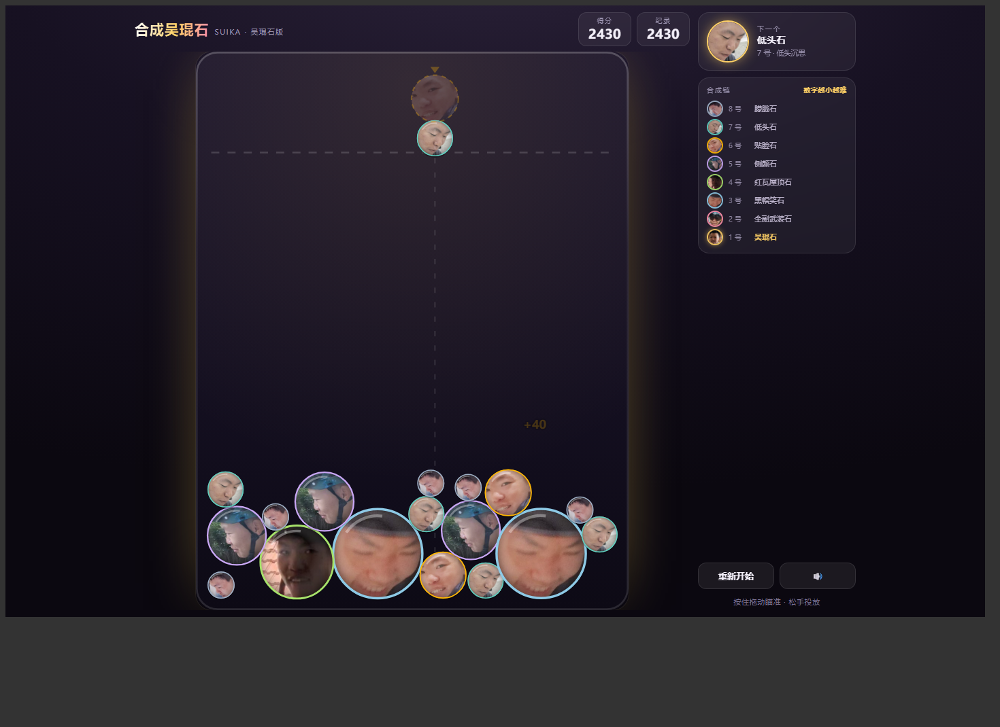

# 合成吴琨石 · SUIKA

一个单文件网页版「合成大西瓜」，材料是 8 张吴琨石的照片——**数字越小越大、越难合成**。



## 玩

- 在线玩：**https://xiudaowuji.github.io/wukunnshi/**
- 仓库：https://github.com/xiudaowuji/wukunnshi
- 本地：下载 `index.html` 双击即可，不需要联网、不需要装任何东西

### 操作

| 平台 | 操作 |
|---|---|
| 电脑 | 鼠标拖动瞄准、松手投放；`←` `→` 移动、`空格` 投放、`R` 重开、`M` 静音 |
| 手机 / 平板 | 按住拖动瞄准、松手投放 |
| 通用 | 界面自适应横竖屏，最高分存本地 |

## 规则

两块**相同**的吴琨石相撞就合成下一号（8+8→7 … 2+2→1），数字越小越难合成。
每次随机掉落 **8 / 7 / 6 / 5 号**（权重 45 / 30 / 17 / 8），所以偶尔会天降大球。
两块 1 号相撞 =「双石合一」，双双消失并 +2000。
堆过虚线并停住约 1.3 秒 → 罐子满了，结算。

| 编号 | 名字 |
|---|---|
| 8 | 朦胧石 |
| 7 | 低头石 |
| 6 | 贴脸石 |
| 5 | 侧颜石 |
| 4 | 红瓦屋顶石 |
| 3 | 黑帽笑石 |
| 2 | 全副武装石 |
| 1 | **吴琨石** |

## 实现

- 物理：Matter.js 0.20（内联进单文件，circle body + sleep）
- 渲染：Canvas 2D 自绘，圆形裁切照片、按等级配色的细描边、合成粒子 / 扩散环 / 飘字
- 音效：WebAudio 现场合成，无音频文件
- 交互：Pointer Events，`touch-action:none` 防止页面跟着滚动
- 版面：罐子高度固定 620 逻辑单位，宽度按窗口比例在 340~480 自适应
- 依赖：**零外部请求**，整个游戏就一个 ~226 KB 的 HTML

## 重新打包

```bash
python build/prep_images.py          # 裁切 8 张人像 -> build/images.json
python build/build.py index.html     # 模板 + Matter.js + 图片 -> index.html
node build/test_logic.js             # 逻辑自检（14 项）
```

- 改名字 / 大小 / 分数：`build/game.template.html` 里的 `LVL` 表
- 改掉落概率：同文件里的 `DROP_POOL`
- 换代照片：改 `build/prep_images.py` 里的 `SPEC`（每张图的裁切中心与缩放）

## License

代码 MIT。照片是朋友的照片，请勿外传他用。
